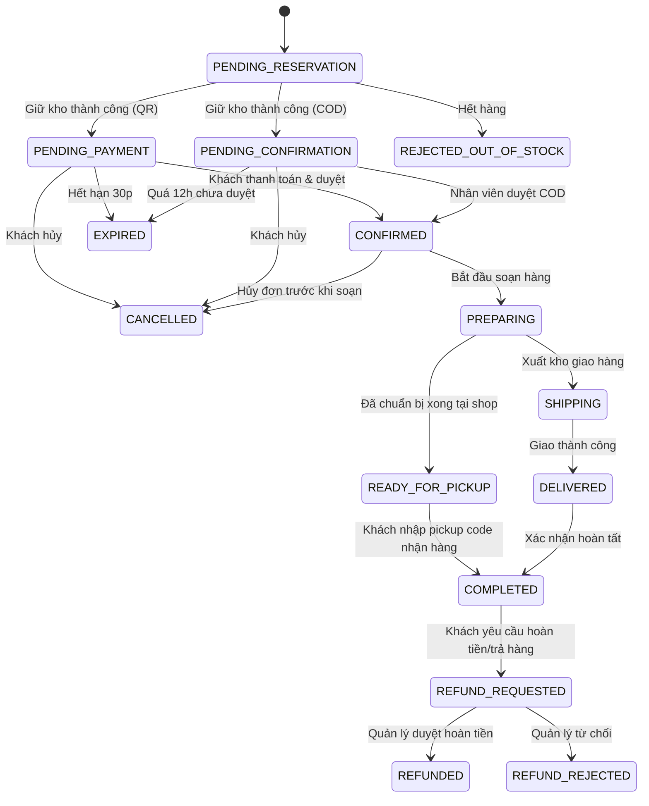
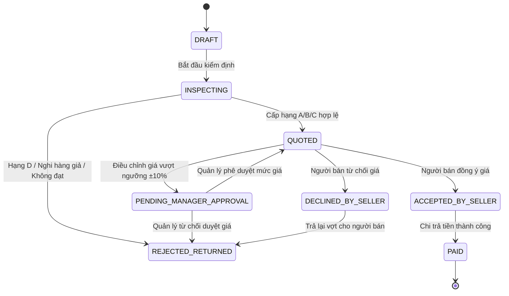
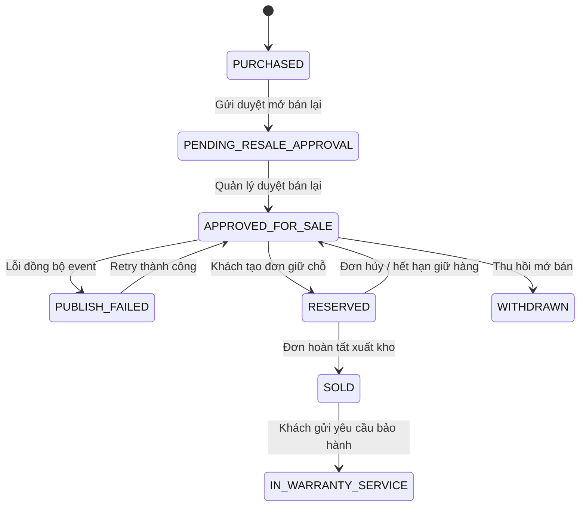

# Sơ Đồ Máy Trạng Thái Nghiệp Vụ (Domain State Machines)

Tài liệu này chuẩn hóa các máy trạng thái nghiệp vụ cốt lõi của hệ thống Badminton Shop theo Master Prompt mục 5.1. Mọi chuyển đổi trạng thái phải được kiểm soát bằng bảng chuyển tiếp (transition table), kiểm tra quyền hạn và ghi nhận audit log.

---

## 1. Máy Trạng Thái Đơn Hàng (Order State Machine)

### Các trạng thái:
- `PENDING_RESERVATION`: Khởi tạo đơn, đang gọi giữ tồn kho.
- `PENDING_PAYMENT`: Đã giữ kho, chờ thanh toán chuyển khoản VietQR (tối đa 30 phút).
- `PENDING_CONFIRMATION`: Đã giữ kho, chờ nhân viên xác nhận đơn COD (tối đa 12 giờ).
- `CONFIRMED`: Đơn hàng đã được xác nhận hợp lệ.
- `PREPARING`: Chi nhánh đang đóng gói và chuẩn bị hàng.
- `SHIPPING`: Đang giao hàng bởi đơn vị vận chuyển (đơn giao tận nơi).
- `READY_FOR_PICKUP`: Hàng đã sẵn sàng tại cửa hàng, đã cấp mã nhận hàng (pickup code).
- `DELIVERED`: Đã giao hàng thành công đến khách.
- `COMPLETED`: Đơn hoàn tất (khách đã nhận hoặc lấy tại cửa hàng).
- `CANCELLED`: Đơn bị hủy (do khách hoặc nhân viên).
- `REJECTED_OUT_OF_STOCK`: Đơn bị từ chối do hết tồn kho khả dụng.
- `EXPIRED`: Đơn hết hạn thanh toán/xác nhận, hệ thống tự động nhả kho.
- `REFUND_REQUESTED`: Yêu cầu hoàn tiền được gửi.
- `REFUNDED`: Quản lý duyệt và hoàn tiền thành công.
- `REFUND_REJECTED`: Từ chối hoàn tiền.

---

## 2. Máy Trạng Thái Phiếu Thu Mua (Buyback Case State Machine)

### Các trạng thái:
- `DRAFT`: Nhân viên mở phiếu tiếp nhận vợt tại quầy.
- `INSPECTING`: Đang thực hiện checklist kiểm định và đánh giá ngoại quan/cấu trúc.
- `QUOTED`: Đã có giá đề xuất từ bảng giá cấu hình (hoặc nhân viên điều chỉnh ±10%).
- `PENDING_MANAGER_APPROVAL`: Giá điều chỉnh vượt ngưỡng ±10%, cần Branch Manager duyệt.
- `ACCEPTED_BY_SELLER`: Khách hàng đồng ý bán lại với mức giá chốt.
- `DECLINED_BY_SELLER`: Khách hàng không đồng ý với mức giá.
- `PAID`: Đã chi tiền mặt / chuyển khoản cho người bán, hoàn tất thu mua.
- `REJECTED_RETURNED`: Vợt bị từ chối thu mua (Hạng D, Unverified, Suspected Fake) và trả lại khách.

---

## 3. Máy Trạng Thái Hồ Sơ Từng Chiếc Vợt Cũ (Second-hand Unit State Machine)

Mỗi chiếc vợt là một đơn vị duy nhất (serial hoặc mã định danh riêng), số lượng chỉ là 0 hoặc 1:
- `PURCHASED`: Đã hoàn tất thu mua từ khách, đang ở kho nội bộ cửa hàng.
- `PENDING_RESALE_APPROVAL`: Đã gửi hồ sơ lên Branch Manager thẩm định để chuẩn bị mở bán.
- `APPROVED_FOR_SALE`: Quản lý duyệt giá bán & tình trạng -> Tạo tồn kho khả dụng (=1) và listing lên web.
- `PUBLISH_FAILED`: Lỗi tạo listing/tồn kho do message broker/hệ thống -> Cần retry thủ công.
- `RESERVED`: Đang được khách đặt mua và giữ chỗ trong một đơn hàng.
- `SOLD`: Đơn hàng hoàn tất, chiếc vợt đã bán ra cho chủ mới.
- `WITHDRAWN`: Rút khỏi danh sách mở bán (thu hồi nội bộ, chuyển mục đích).
- `IN_WARRANTY_SERVICE`: Đang trong quy trình bảo hành/sửa chữa.

---

## 4. Máy Trạng Thái Phiếu Điều Chuyển Hàng (Stock Transfer State Machine)

- `DRAFT`: Tạo phiếu điều chuyển giữa 2 chi nhánh.
- `APPROVED`: Quản lý duyệt điều chuyển.
- `IN_TRANSIT`: Xuất kho gửi thực tế -> Trừ kho gửi, hàng ở trạng thái in-transit (không ai bán được).
- `RECEIVED`: Kho nhận đã kiểm đếm đầy đủ 100%.
- `PARTIALLY_RECEIVED`: Kho nhận nhận thiếu hoặc hỏng một phần -> Tự động sinh biên bản `discrepancy`.
- `CANCELLED`: Hủy phiếu điều chuyển trước khi xuất kho.

---

## 5. Máy Trạng Thái Yêu Cầu Bảo Hành (Warranty Claim State Machine)

- `SUBMITTED`: Khách hàng hoặc chi nhánh tạo yêu cầu bảo hành.
- `RECEIVED`: Cửa hàng đã tiếp nhận cây vợt cần bảo hành.
- `INSPECTING`: Kỹ thuật viên kiểm tra kết cấu khung, nguyên nhân hư hỏng.
- `APPROVED`: Bảo hành hợp lệ (lỗi nhà sản xuất hoặc lỗi kết cấu cam kết).
- `REJECTED`: Từ chối bảo hành (lỗi do người dùng: va chạm vợt, căng quá số kg quy định).
- `RESOLVED`: Hoàn tất xử lý (sửa chữa, đổi vợt tương đương, hoặc hoàn tiền).
- `CLOSED`: Khách hàng đã nhận lại sản phẩm, đóng hồ sơ bảo hành.
